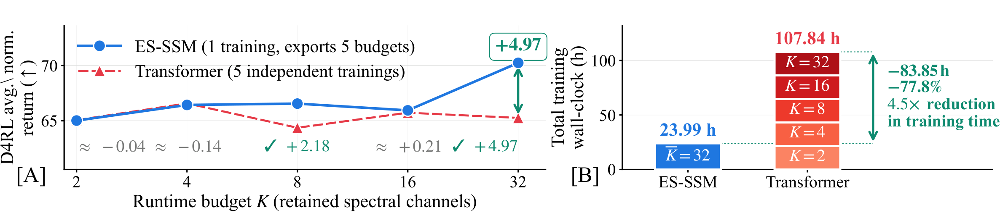

# ES-SSM

Elastic Spectral State Space Models for Train-Once Budgeted Inference

Dachuan Song, Junyu Yin, Zechen Hu, Xuan Wang

NeurIPS 2026, Main Track (Poster).

[Paper](https://arxiv.org/abs/2601.22488) · [Hugging Face](https://huggingface.co/Dachuan99/ES-SSM) · [Usage](#usage) · [ESSH follow-up](https://arxiv.org/abs/2609.32486) · [Citation](#citation)

## Overview

ES-SSM trains a spectral state space model once and exports compact models for different compute budgets. Its fixed Hankel spectral basis provides a naturally ordered channel axis. Keeping the first `K` channels sets the approximation resolution of the SSM sequence operator, so the spectral-channel count directly controls model capacity.

Training uses learned channel projections, input-adaptive channel-wise gates, and budget dropout to optimize the same retained prefixes used at inference. This encourages early channels to remain predictive at small budgets, while later channels provide refinements at larger budgets. At deployment, direct prefix truncation removes channels beyond `K` and their associated parameters to produce an independently deployable compact model. No budget-specific retraining, channel search, or reordering is required.


Figure 1. The ES-SSM residual block and spectral sublayer. The retained channels determine the spectral approximation resolution used by the compact model.

## Experiments

The paper evaluates ES-SSM on byte-level language modeling, Long Range Arena, Speech Commands V2, and D4RL offline reinforcement learning.


Figure 3. SlimPajama results for the 1.3B-parameter family trained on 30B byte-tokens. Test bits per byte (BPB) is plotted against spectral budget and inference throughput (sequence length 2048, batch 1, one B200 GPU). Dashed curves are non-elastic references trained separately at each capacity.



Figure 4. D4RL normalized returns and total training time across nine datasets and three seeds on RTX 3090. ES-SSM uses one training run per dataset and seed to obtain five compact budgets; the Transformer reference is trained separately at each budget.

## Usage

This repository includes the ES-SSM language-modeling and D4RL experiments. Datasets and trained checkpoints are not included.

### Installation

Use Python 3.10 or later and PyTorch 2.4 or later. Install a PyTorch build suitable for your hardware; the full language-modeling experiment uses CUDA.

```bash
git clone https://github.com/GMU-MICO/ES-SSM.git
cd ES-SSM
python -m pip install -r requirements.txt
python smoke_test.py
```

The smoke test runs small CPU checks with synthetic data, including training, inference, causality, and compact-model equivalence.

### Language modeling

Download the SlimPajama parquet files used by the scripts:

```bash
python download_slimpajama.py --out-dir ./datasets/slimpajama \
  --train-files 250 --val-files 30 --test-files 30
```

These counts download the full mirror. Omit the three shard-count flags to download one shard per split. The downloader records the resolved dataset revision and file hashes in `download_manifest.json`; use `--revision` to select a specific revision.

Train ES-SSM:

```bash
torchrun --nproc_per_node=1 essm_LM.py \
  --data-dir ./datasets/slimpajama --output-dir ./runs/essm \
  --filter-cache-dir ./cache/filter
```

The default `CFG` in `essm_LM.py` runs the 1.3B-family experiment with a training target of 30B byte-tokens. Model dimensions, training settings, and evaluation budgets are configured there.

Evaluate a checkpoint across the configured budgets:

```bash
python essm_LM.py --inference-only \
  --checkpoint ./runs/essm/checkpoints/best.pt \
  --data-dir ./datasets/slimpajama --output-dir ./runs/essm \
  --filter-cache-dir ./cache/filter
```

For each budget in `CFG["eval_k"]`, evaluation uses `build_compact` to construct a smaller model containing only the retained channels and parameters.

### Offline reinforcement learning

```bash
python -m pip install -r requirements-rl.txt
bash reproduce_DL.sh
```

This runs the D4RL MuJoCo experiments, exports compact checkpoints at `K = 2, 4, 8, 16, 32`, and evaluates them. See [the offline RL guide](docs/offline_rl.md) for individual commands and settings.

### Files

| File | Contents |
| --- | --- |
| `essm_LM.py` | Language-model training and compact-model evaluation |
| `d4rl_mujoco_RL.py` | D4RL training, checkpoint export, and evaluation |
| `runtime_utils.py` | Hankel filters, data caches, and checkpoint utilities |
| `download_slimpajama.py` | SlimPajama download and revision manifest |
| `smoke_test.py` | Functional checks with small models and synthetic data |

## Follow-up work

[Elastic Selective Spectral Hybrids for Train-Once, Export-Many Budgeted Inference (ESSH)](https://arxiv.org/abs/2609.32486) extends this direction to hybrid language models. It combines selective spectral mixers with input-dependent decay and write/read gates, sliding-window attention, and joint training of spectral-channel count and feed-forward width.

With a 1.53B model on B300, fused recurrent decoding takes 1.37 ms/token at batch size 1 after a 2K context. In the paper's parameter-matched CUDA-graph benchmark, this is 3.03× faster than Transformer++ and 2.14–2.80× faster than the tested Mamba-2 and Mamba-3 implementations ([Appendix R, Table 59](https://arxiv.org/html/2609.32486v1)).

## Citation

BibTeX entries for ES-SSM and the ESSH follow-up:

```bibtex
@misc{song2026elasticspectralstatespace,
  title={Elastic Spectral State Space Models for Train-Once Budgeted Inference},
  author={Dachuan Song and Junyu Yin and Zechen Hu and Xuan Wang},
  year={2026},
  eprint={2601.22488},
  archivePrefix={arXiv},
  primaryClass={cs.LG},
  url={https://arxiv.org/abs/2601.22488},
}

@misc{song2026elasticselectivespectralhybrids,
  title={Elastic Selective Spectral Hybrids for Train-Once, Export-Many Budgeted Inference},
  author={Dachuan Song and Chuchu Chen and Xuan Wang},
  year={2026},
  eprint={2609.32486},
  archivePrefix={arXiv},
  primaryClass={cs.LG},
  url={https://arxiv.org/abs/2609.32486},
}
```

## License

The code is released under the [Apache License 2.0](LICENSE).
